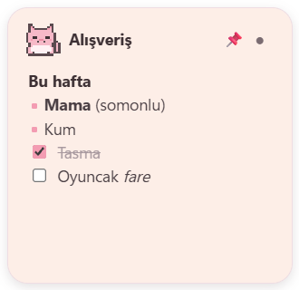

# Wakai Desktop

**Windows 11 masaüstünüz için pastel pembe, piksel kedili, hafif widget platformu.**

Takvim, görevler, notlar, saat, odak zamanlayıcısı, hava durumu, müzik ve sistem bilgisi;
doğrudan duvar kağıdınızın üzerinde, simgelerinizin altında, pencerelerinizin arkasında.

  

---

## ✨ Neden Wakai Desktop?

- **Gerçekten masaüstünde yaşar.** Widget'lar Windows 11 duvar kağıdı katmanına yerleşir: masaüstü simgeleri üstlerinde kalır, açtığınız her pencere önlerine geçer. "Her zaman üstte" pencereler değildirler.
- **Dokununca uyanır.** İmleci bir widget'ın üzerine getirdiğinizde öne çıkar; tıklayabilir, yazabilir, sürükleyebilir, boyutlandırabilirsiniz. İmleç ayrılınca masaüstüne geri döner.
- **Hafiftir.** 9 widget açıkken boşta işlemcinin yaklaşık %0,03–0,1'ini kullanır; widget'lar gizliyken yalnızca 2,6 MB bellek. Tüm sayılar [ölçülmüştür](docs/PERFORMANS.md).
- **Tamamen yerel ve Türkçe.** Hesap yok, bulut yok. Verileriniz bilgisayarınızda, SQLite veritabanında. Yalnızca Hava Durumu Kedisi internete bağlanır.
- **Sevimli.** Özgün piksel kedi ailesi: göz kırpan, kuyruk sallayan, uyuyan, kutlama yapan kediler.

## 🐾 Widget'lar

| | Widget | Neler yapar? |
|---|---|---|
| 📅 | **Takvim Kedisi** | Türkçe aylık takvim, bugün ve hafta sonu vurgusu, etkinlik ekleme/düzenleme/silme, kategoriler, renk etiketleri, hatırlatıcılar, yaklaşan etkinlikler. |
| ✅ | **Görev Kedisi** | Öncelik, son tarih, kategori, hatırlatıcı; gecikme vurgusu, ilerleme çubuğu ve tamamlayınca küçük bir kutlama. |
| 📝 | **Not Kedisi** | Otomatik kaydedilen yapışkan notlar, sabitleme, renkler, basit biçimlendirme (başlık, madde, yapılacak kutusu, **kalın**, *italik*). |
| 🕐 | **Saat Kedisi** | Dijital ya da analog; saniye, 12/24 saat, tarih ve ek saat dilimleri. |
| 🍅 | **Odak Kedisi** | Pomodoro: çalışma, kısa ve uzun molalar, oturum takibi, bildirimler. |
| 🌤️ | **Hava Durumu Kedisi** | Konum arama, anlık durum ve 5 günlük tahmin (Open-Meteo, API anahtarı gerekmez); çevrim dışıyken son veri. |
| 🎵 | **Müzik Kedisi** | Spotify, tarayıcılar, Medya Oynatıcı… Windows medya oturumundaki parça, kapak ve oynatma kontrolleri. |
| 💻 | **Sistem Kedisi** | İşlemci, bellek, GPU ve disk kullanımı; ayarlanabilir yenileme aralığı. |

  
  
  

  
  
  

## 🎛️ Kontrol Merkezi

Widget'ları, takvimi, görevleri, notları ve tüm ayarları tek yerden yönetin: Genel Bakış, Widget'larım, Widget Mağazası, Takvim, Görevler, Notlar, Görünüm, Performans, Bildirimler ve Ayarlar (yedekleme ve geri yükleme dahil).

## 📦 Kurulum

1. [Sürümler](https://github.com/efecrtgl/Wakai-Desktop/releases) sayfasından `Wakai Desktop_1.0.0_x64-setup.exe` dosyasını indirin (yaklaşık 2,5 MB).
2. Çalıştırın. Yönetici izni gerekmez; uygulama yalnızca sizin kullanıcı hesabınıza kurulur.
3. Kontrol Merkezi açılır → **Widget Mağazası**'ndan ilk kedinizi ekleyin.

Gereksinimler: Windows 11 (24H2 ve sonrası önerilir) ve Windows 11 ile gelen WebView2 Runtime. Ayrıntılar ve kaynaktan derleme: [Kurulum](docs/KURULUM.md).

### İpuçları

- Widget'ı taşımak için üzerine gelip **üst kenarından** sürükleyin; boyutlandırmak için **sağ alt köşesini** kullanın.
- **Sağ tık** menüsü: widget ayarları, tıklamaları geçir, gizle, kaldır.
- Bir widget'ı tıklama geçirgen yaptıysanız tepsi menüsündeki **"Tüm widget'ları etkileşimli yap"** ile geri alabilirsiniz.
- Kontrol Merkezi'ni kapatınca uygulama sistem tepsisinde çalışmaya devam eder (Ayarlar'dan değiştirilebilir).

## 🛠️ Teknoloji

| Katman | Teknoloji |
|---|---|
| Çekirdek | **Rust**: yaşam döngüsü, Windows masaüstü entegrasyonu (Win32), zamanlayıcılar, izleme |
| Masaüstü çatısı | **Tauri 2** + WebView2 |
| Arayüz | **React** (JavaScript, TypeScript yok) + CSS tasarım belirteçleri |
| Veri | **SQLite** (`rusqlite`, sürümlü göçler, otomatik yedek) |
| Windows API'leri | Progman/WorkerW, Raw Input, GSMTC (medya), PDH (GPU), WinHTTP |

## 📚 Belgeler

- [Mimari](docs/MIMARI.md) · [Windows Entegrasyonu](docs/WINDOWS_ENTEGRASYONU.md) · [Widget Sistemi](docs/WIDGET_SISTEMI.md)
- [Veritabanı](docs/VERITABANI.md) · [Performans](docs/PERFORMANS.md) · [Testler](docs/TESTLER.md)
- [Kurulum](docs/KURULUM.md) · [Geliştirici Rehberi](docs/GELISTIRICI_REHBERI.md) · [Katkıda Bulunma](CONTRIBUTING.md)
- [Yol Haritası](docs/ROADMAP.md) · [Değişiklik Günlüğü](CHANGELOG.md)

## ⚠️ Bilinen Sınırlamalar

- Yalnızca Windows 11 desteklenir; 24H2 öncesi masaüstü düzeni kodda desteklenir ama gerçek cihazda test edilmedi.
- Simgelerle çakışan bir widget'ın üzerine gelindiğinde widget, o an simgelerin üstünde görünür.
- Explorer'ın yeniden başlatılması ve monitör çıkarıp takma senaryoları kodda ele alınır ancak gerçek cihazda test edilmedi.
- Tam liste: [Windows Entegrasyonu → Bilinen Sınırlamalar](docs/WINDOWS_ENTEGRASYONU.md).

## 🗺️ Yol Haritası

İlk sürümden sonra: ek temalar (tasarım sistemi hazır), güvenli bir eklenti modeli araştırması, ek diller. Ayrıntılar: [Yol Haritası](docs/ROADMAP.md).

## 📄 Lisans

[MIT](LICENSE). Hava durumu verisi: [Open-Meteo](https://open-meteo.com) (CC BY 4.0).
