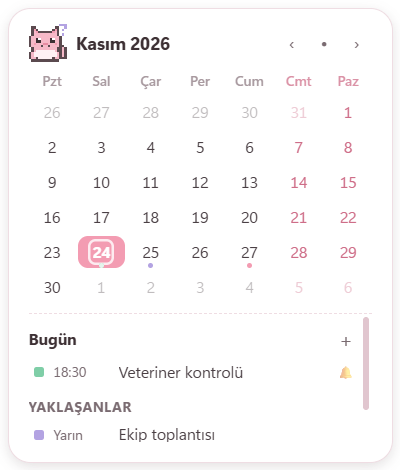
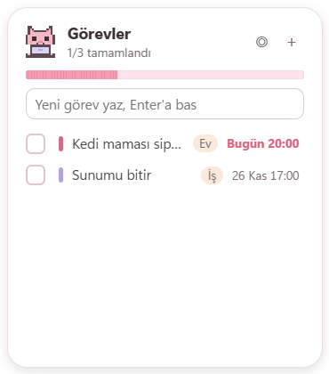
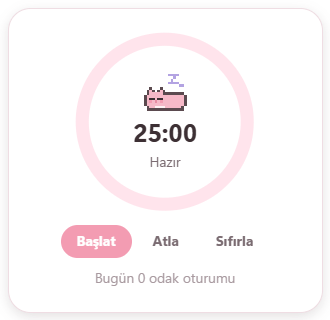
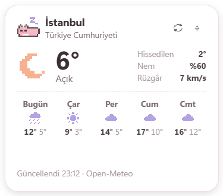
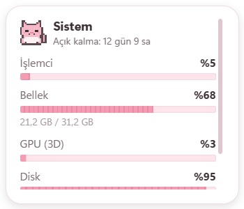
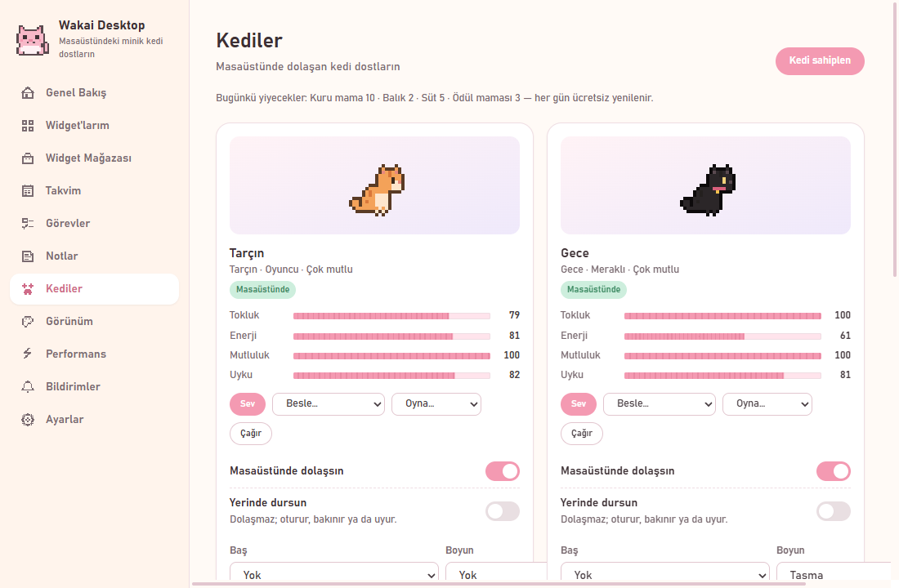
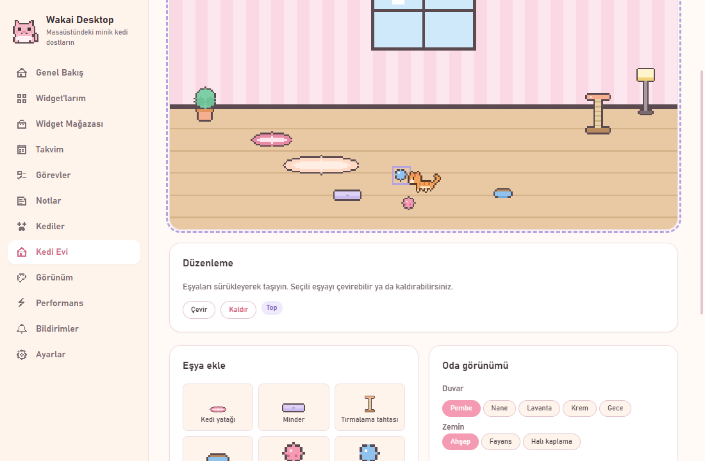
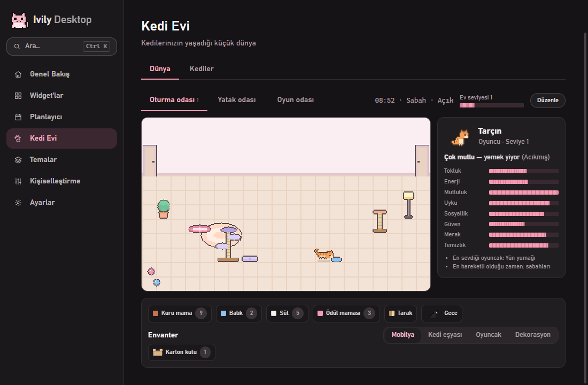
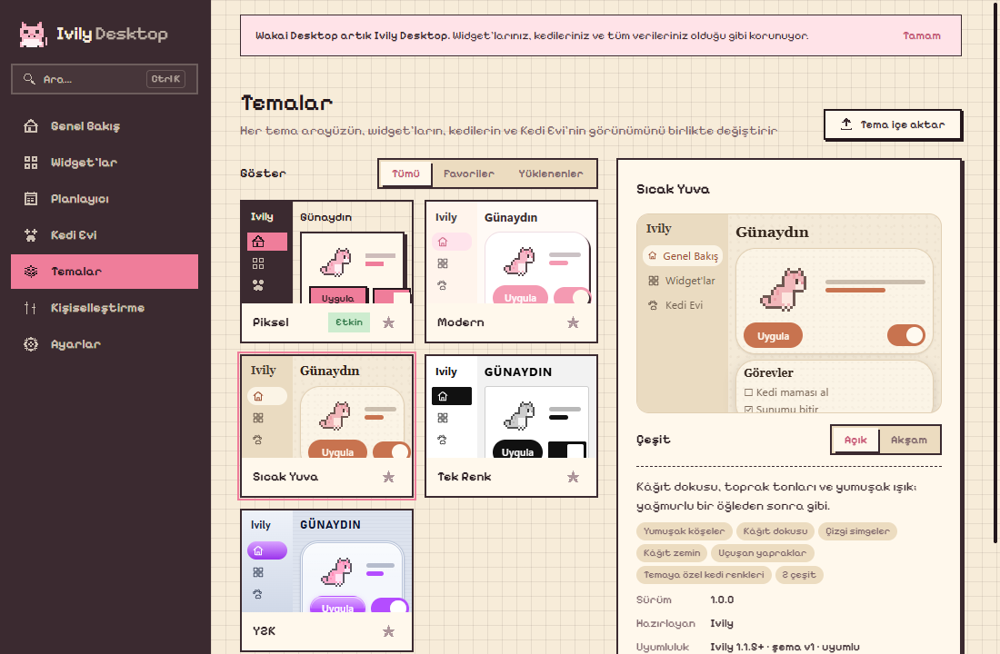
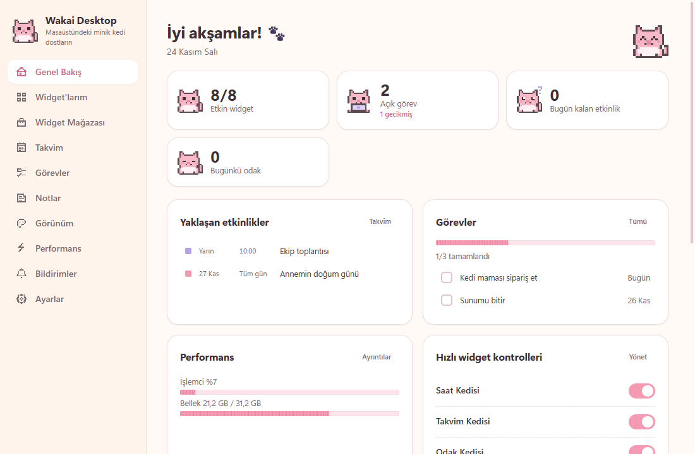

# Ivily Desktop

(1.1.0 ve öncesinde adı Wakai Desktop idi)

**Windows 11 masaüstünüz için piksel kedili, temalı, hafif widget platformu ve oynanabilir bir Kedi Evi.**

Takvim, görevler, notlar, saat, odak zamanlayıcısı, hava durumu, müzik ve sistem bilgisi;
doğrudan duvar kağıdınızın üzerinde, simgelerinizin altında, pencerelerinizin arkasında.
Ve artık masaüstünüzde dolaşan, pencerelerin üstüne zıplayan piksel kediler. 🐈

  

---

## ✨ Neden Ivily Desktop?

- **Gerçekten masaüstünde yaşar.** Widget'lar Windows 11 duvar kağıdı katmanına yerleşir: masaüstü simgeleri üstlerinde kalır, açtığınız her pencere önlerine geçer. "Her zaman üstte" pencereler değildirler.
- **Dokununca uyanır.** İmleci bir widget'ın üzerine getirdiğinizde öne çıkar; tıklayabilir, yazabilir, sürükleyebilir, boyutlandırabilirsiniz. İmleç ayrılınca masaüstüne geri döner.
- **Hafiftir.** 9 widget açıkken boşta işlemcinin yaklaşık %0,03–0,1'ini kullanır; widget'lar gizliyken yalnızca 2,6 MB bellek. Tüm sayılar [ölçülmüştür](docs/PERFORMANS.md).
- **Tamamen yerel ve Türkçe.** Hesap yok, bulut yok. Verileriniz bilgisayarınızda, SQLite veritabanında. İnternete yalnızca Hava Durumu Kedisi ve (kapatılabilir) güncelleme denetimi bağlanır.
- **Sevimli.** Özgün piksel kedi ailesi: göz kırpan, kuyruk sallayan, uyuyan, kutlama yapan kediler.
- **Size göre.** Beş tema (Piksel, Modern, Sıcak Yuva, Tek Renk, Y2K), vurgu rengi, yoğunluk, yazı boyutu ve yüksek karşıtlık.

## 🐾 Widget'lar

| | Widget | Neler yapar? |
|---|---|---|
| 📅 | **Takvim Kedisi** | Türkçe aylık takvim, bugün ve hafta sonu vurgusu, etkinlik ekleme/düzenleme/silme, kategoriler, renk etiketleri, hatırlatıcılar, yaklaşan etkinlikler. |
| ✅ | **Görev Kedisi** | Öncelik, son tarih, kategori, hatırlatıcı; gecikme vurgusu, ilerleme çubuğu ve tamamlayınca küçük bir kutlama. |
| 📝 | **Not Kedisi** | Otomatik kaydedilen yapışkan notlar, sabitleme, renkler, basit biçimlendirme (başlık, madde, yapılacak kutusu, **kalın**, *italik*). |
| 🕐 | **Saat Kedisi** | Dijital ya da analog; saniye, 12/24 saat, tarih ve ek saat dilimleri. |
| 🍅 | **Odak Kedisi** | Pomodoro: çalışma, kısa ve uzun molalar, oturum takibi, bildirimler. |
| 🌤️ | **Hava Durumu Kedisi** | Konum arama, anlık durum ve 5 günlük tahmin (Open-Meteo, API anahtarı gerekmez); çevrim dışıyken son veri. |
| 🎵 | **Müzik Kedisi** | Spotify, tarayıcılar, Medya Oynatıcı… Windows medya oturumundaki parça, kapak ve oynatma kontrolleri. |
| 💻 | **Sistem Kedisi** | İşlemci, bellek, GPU ve disk kullanımı; ayarlanabilir yenileme aralığı. |

  
  
  

  
  
  

## 🐈 Masaüstü kedileri

Yerel ve hafif bir kedi motoru (Rust, WebView kullanmaz): kediler görev çubuğunda ve açık pencerelerin üstünde yürür, zıplar, uyur, oynar. Tıklamaları engellemez, odağı çalmaz; tam ekran oyun ve videolarda gizlenir.

- 8 cins, 6 kişilik; tokluk, enerji, mutluluk ve uyku ihtiyaçları (uygulama kapalıyken de yavaşça değişir).
- Besleme, sevme (fareyle okşama), oyuncaklar, aksesuarlar, başarımlar. Satın alma yok.
- **Kedi Evi:** eşyalarla döşenebilen, kedilerin kendi başına yaşadığı oda.
- İki kedi masaüstündeyken bile ek bellek ≈ 0,3 MB, işlemci kullanımı ölçülemeyecek kadar düşük ([ölçümler](docs/PERFORMANCE.md)). Ayrıntılar: [Kediler](docs/KEDILER.md).

  
  

## ⚡ Profiller

Tek tıkla **Çalışma, Oyun, Dinlenme, Odaklanma** ya da kendi profilinize geçin: hangi widget'ların görüneceği, kedilerin etkinliği, animasyonlar ve bildirimler birlikte değişir; widget konumları korunur. Tepsi menüsünden de geçilebilir; isteğe bağlı olarak tam ekran bir oyun açılınca Oyun profiline otomatik geçilir.

## 🔄 Güncellemeler ve güvenlik ağı

- Yeni sürümler GitHub Releases'tan **imzalı** olarak gelir; onayınız olmadan kurulmaz ([Güncellemeler](docs/GUNCELLEMELER.md)).
- Kurulumdan önce verileriniz yedeklenir ve mevcut sürüm saklanır; sorun olursa **Ayarlar → Sürüm geçmişi**'nden önceki sürüme dönebilirsiniz.
- Yedekler doğrulanır; geri yüklerken tümünü ya da yalnızca istediğiniz kategorileri (ör. yalnızca görevler) geri alabilirsiniz ([Yedekler](docs/YEDEKLER.md)).

## 🏠 Kedi Evi

Kedilerinizin kendi kararlarıyla yaşadığı küçük bir oyun dünyası: üç oda, mobilyalar, oyuncaklar, gün ve gece, pencereden yağmur ve kar. Kediyi imleçle sevin, kucağınıza alın, oyuncak fırlatın, mamayı kaba sürükleyin; eşyaları yerleştirip döndürün. Kediler ihtiyaçlarına, kişiliklerine ve alışkanlıklarına göre uyur, yer, oynar, tırmanır, pencereden bakar, arkadaşlarına sokulur ya da saklanır; ne yaptıklarını ve nedenini görebilirsiniz. Ayrıntılar: [Kedi Evi](docs/KEDI_EVI.md).

## 🎨 Temalar

Her tema arayüzü, widget'ları, simgeleri, kedilerin renklerini ve Kedi Evi'ni birlikte değiştirir; yeniden başlatma gerekmez, yerleşiminiz ve kedileriniz değişmez. Tema kitaplığında temaları kendi önizlemelerinde inceleyin, uygulamanın tamamında deneyin, `.ivilytheme` olarak içe ve dışa aktarın. Kendi temanızı yapmak için: [Tema API'si](docs/THEME_API.md).

## 🎛️ Kontrol Merkezi

Genel Bakış, Widget'lar, Planlayıcı (takvim, görevler, notlar), Kedi Evi, Temalar, Kişiselleştirme ve Ayarlar. **Ctrl+K** ile her ayarı arayıp doğrudan ona gidebilirsiniz.

## 📦 Kurulum

1. [Sürümler](https://github.com/efecrtgl/Wakai-Desktop/releases) sayfasından `Ivily Desktop_1.1.5_x64-setup.exe` dosyasını indirin.
2. Çalıştırın. Yönetici izni gerekmez; uygulama yalnızca sizin kullanıcı hesabınıza kurulur.
3. Kontrol Merkezi açılır → **Widget'lar → Widget ekle**'den ilk widget'ınızı ekleyin, **Kedi Evi → Kediler**'den ilk kedinizi sahiplenin.

Wakai Desktop kullanıyorsanız Ivily Desktop yükleyicisini üzerine kurun: verileriniz, widget'larınız ve kedileriniz korunur; eski kısayollar ve kaldırma kaydı Ivily'ye taşınır ([Geçiş](docs/IVILY_BRAND_MIGRATION.md)).

Gereksinimler: Windows 11 (24H2 ve sonrası önerilir) ve Windows 11 ile gelen WebView2 Runtime. Ayrıntılar ve kaynaktan derleme: [Kurulum](docs/KURULUM.md).

### İpuçları

- Widget'ı taşımak için üzerine gelip **üst kenarından** sürükleyin; boyutlandırmak için **sağ alt köşesini** kullanın.
- **Sağ tık** menüsü: widget ayarları, tıklamaları geçir, gizle, kaldır.
- Bir widget'ı tıklama geçirgen yaptıysanız tepsi menüsündeki **"Tüm widget'ları etkileşimli yap"** ile geri alabilirsiniz.
- Kontrol Merkezi'ni kapatınca uygulama sistem tepsisinde çalışmaya devam eder (Ayarlar'dan değiştirilebilir).

## 🛠️ Teknoloji

| Katman | Teknoloji |
|---|---|
| Çekirdek | **Rust**: yaşam döngüsü, Windows masaüstü entegrasyonu (Win32), zamanlayıcılar, izleme |
| Masaüstü çatısı | **Tauri 2** + WebView2 |
| Arayüz | **React** (JavaScript, TypeScript yok) + bildirimsel tema motoru + canvas tabanlı Kedi Evi |
| Veri | **SQLite** (`rusqlite`, sürümlü göçler, otomatik yedek) |
| Windows API'leri | Progman/WorkerW, Raw Input, GSMTC (medya), PDH (GPU), WinHTTP |

## 📚 Belgeler

- [Mimari](docs/MIMARI.md) · [Windows Entegrasyonu](docs/WINDOWS_ENTEGRASYONU.md) · [Widget Sistemi](docs/WIDGET_SISTEMI.md)
- [Veritabanı](docs/VERITABANI.md) · [Performans](docs/PERFORMANS.md) · [1.1.0 ölçümleri](docs/PERFORMANCE.md) · [Testler](docs/TESTLER.md)
- [Kediler](docs/KEDILER.md) · [Güncellemeler](docs/GUNCELLEMELER.md) · [Yedekler](docs/YEDEKLER.md) · [Geliştirme günlüğü](docs/DEVELOPMENT-LOG.md)
- 1.1.5: [Sürüm notları](docs/IVILY_1.1.5_SURUM_NOTLARI.md) · [Kedi Evi](docs/KEDI_EVI.md) · [Tema API'si](docs/THEME_API.md) · [Mimari](docs/IVILY_1.1.5_ARCHITECTURE.md) · [Testler](docs/IVILY_1.1.5_TESTING.md) · [Güvenlik](docs/IVILY_SECURITY.md) · [Ad geçişi](docs/IVILY_BRAND_MIGRATION.md) · [Yol haritası](docs/IVILY_1.1.5_ROADMAP.md)
- [Kurulum](docs/KURULUM.md) · [Geliştirici Rehberi](docs/GELISTIRICI_REHBERI.md) · [Katkıda Bulunma](CONTRIBUTING.md)
- [Yol Haritası](docs/ROADMAP.md) · [Değişiklik Günlüğü](CHANGELOG.md)

## ⚠️ Bilinen Sınırlamalar

- Yalnızca Windows 11 desteklenir; 24H2 öncesi masaüstü düzeni kodda desteklenir ama gerçek cihazda test edilmedi.
- Simgelerle çakışan bir widget'ın üzerine gelindiğinde widget, o an simgelerin üstünde görünür.
- Explorer'ın yeniden başlatılması ve monitör çıkarıp takma senaryoları kodda ele alınır ancak gerçek cihazda test edilmedi.
- Masaüstü kedilerinin fareyle okşanması ve pencere üstüne zıplaması kodda var, ancak gerçek fareyle test edilmedi. Kedi Evi etkileşimleri sentetik fare olaylarıyla test edildi.
- Kedi Evi'nde kediler odalar arasında kendiliğinden geçmez; kapıya sürüklenerek taşınır.
- Kenarlıksız pencere kipindeki bazı oyunlar tam ekran olarak algılanmayabilir (kediler gizlenmez, otomatik Oyun profili devreye girmez).
- Önceki sürüme dönüş yalnızca programı değiştirir; Windows "Uygulamalar" listesindeki sürüm numarası bir sonraki güncellemeye kadar eski kalır.
- Tam liste: [Windows Entegrasyonu → Bilinen Sınırlamalar](docs/WINDOWS_ENTEGRASYONU.md).

## 🗺️ Yol Haritası

Sonraki adımlar: kedilerin odalar arasında kendiliğinden gezmesi, bahçe ve balkon odaları, ortam sesleri, ek temalar, ek diller. Ayrıntılar: [Yol Haritası](docs/ROADMAP.md).

## 📄 Lisans

[MIT](LICENSE). Hava durumu verisi: [Open-Meteo](https://open-meteo.com) (CC BY 4.0).
